<p align="center">
  
</p>

<h3 align="center">Nothing goes live without your say-so.</h3>

<p align="center">
  A client portal for social media agencies. The agency plans and creates the posts.<br>
  The client previews each one and approves it before it's published.
</p>

<p align="center">
  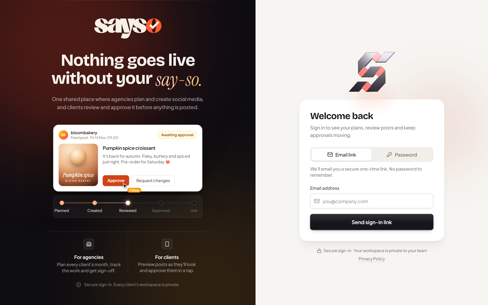
</p>

## The problem it solves

Running social media for a client usually means approvals scattered across WhatsApp, email and shared folders. Someone approves the wrong version. A post goes out that nobody signed off. The client has no idea what's planned for next week.

Sayso puts all of that in one place:

- **The agency** plans the month, uploads each post, and sees what's waiting on whom.
- **The client** gets a notification, sees the post exactly as it will appear, and taps **Approve** or **Request changes**.
- **Nothing is published** until the client has approved it. The database enforces that rule, so it can't be skipped by accident.

## A quick tour

The screenshots use a made-up client, Luma Candle Co.

### For the client: preview, then approve

Each post shows its photos and videos exactly as uploaded, with the caption and hashtags underneath. The client swipes through them, then approves the post or says what to change.

<p align="center">
  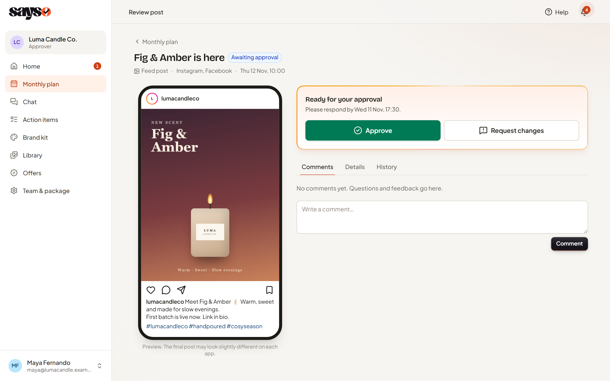
</p>

It works just as well on a phone, which is where most clients will open it.

<p align="center">
  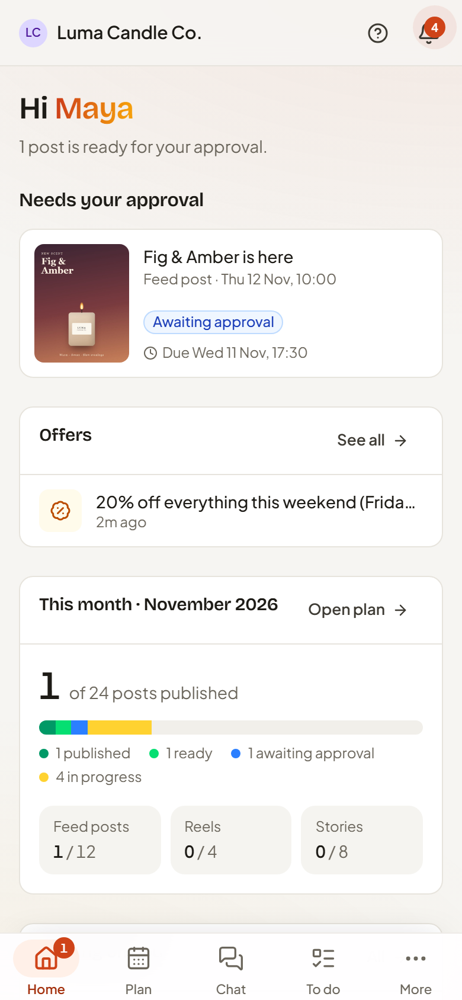
  &nbsp;&nbsp;&nbsp;
  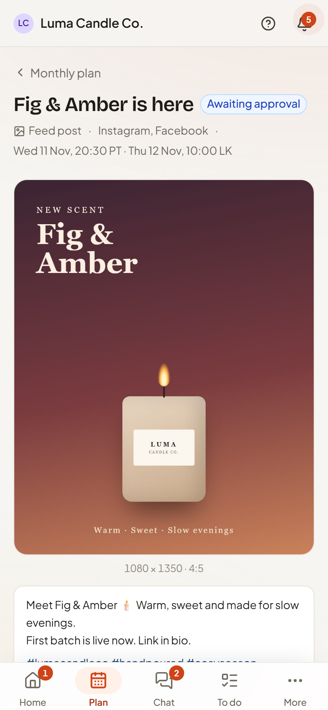
</p>

### For the agency: every client at a glance

The dashboard shows what needs attention today, what's waiting with clients, and any offers clients have told you about.

<p align="center">
  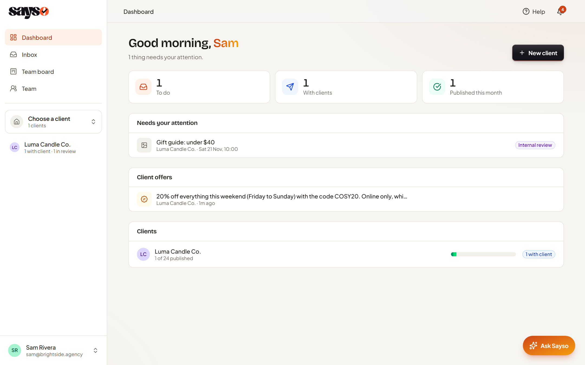
</p>

### Chat with the client, in the same place

Each client has a chat with the agency team, plus a team-only chat the client never sees. Reply to a specific message, react with an emoji, edit what you sent, and open or download photos.

<p align="center">
  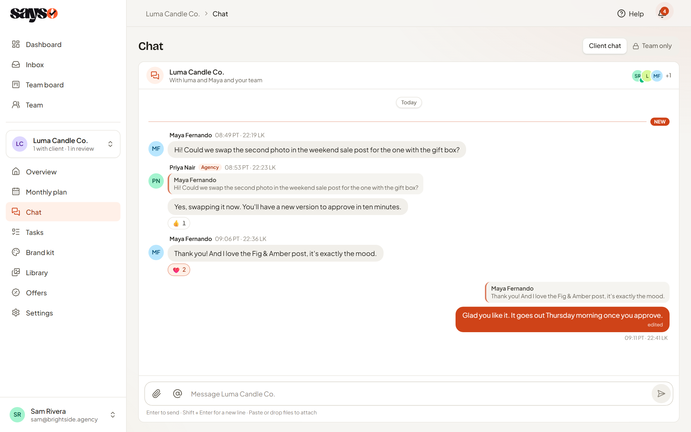
</p>

### The month in one calendar

Every post for the month, colour-coded by stage, with the client's key dates marked.

<p align="center">
  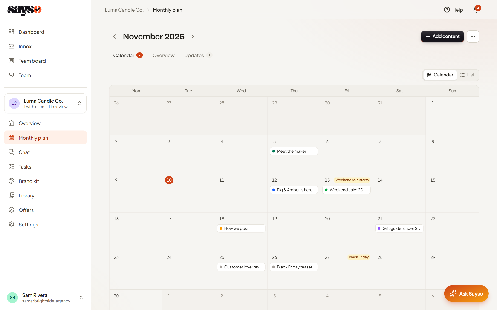
</p>

The Overview tab sorts the same posts into **Ready**, **Needs approval** and **In progress**, next to progress against the client's package.

<p align="center">
  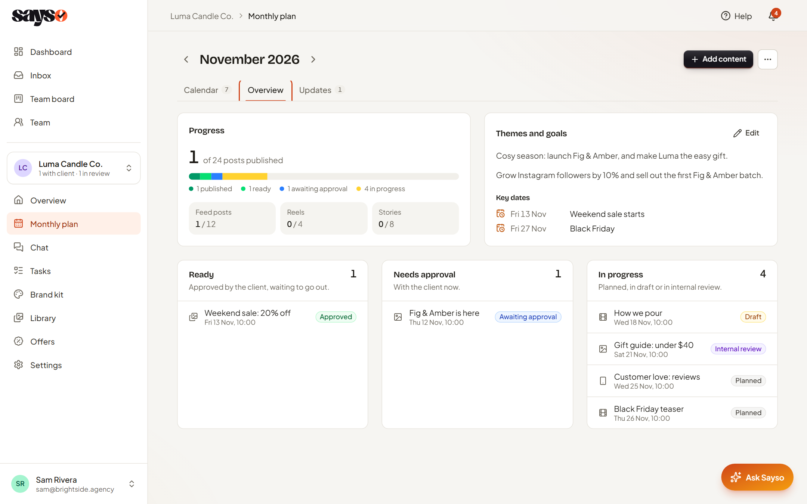
</p>

### A brand kit everyone follows

Colours, fonts, tone of voice, topics to avoid and approved answers to common questions, in one page the whole team works from.

<p align="center">
  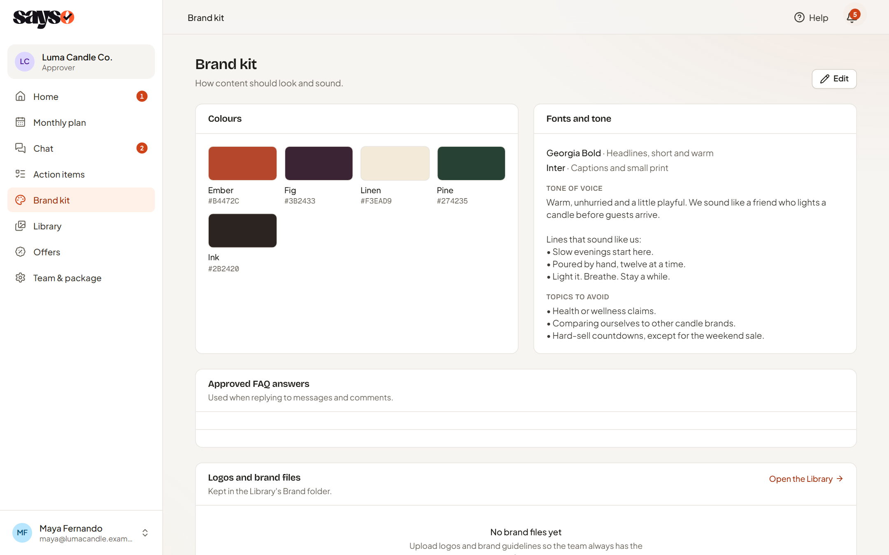
</p>

### A first sign-in that explains itself

New clients set up their profile in about two minutes, then get a short tour that opens each page and says what it's for.

<p align="center">
  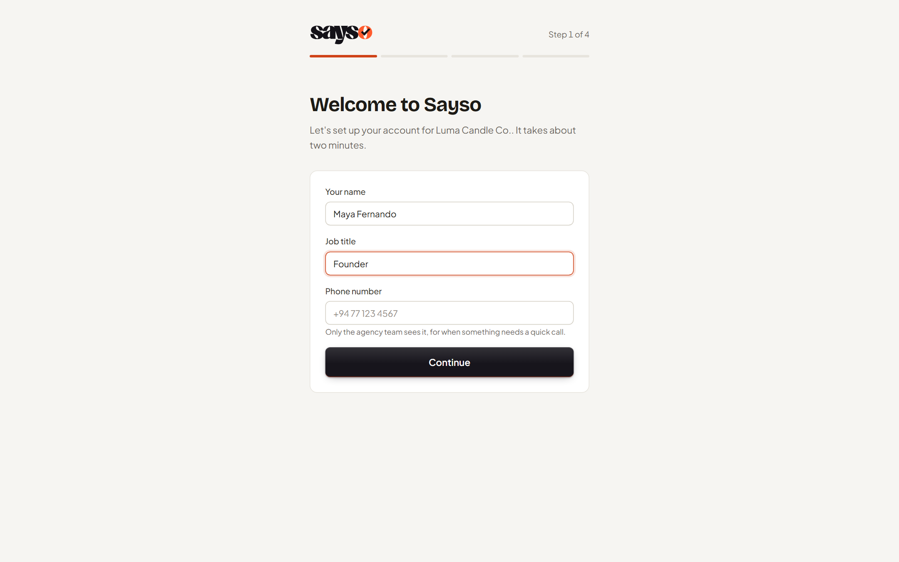
  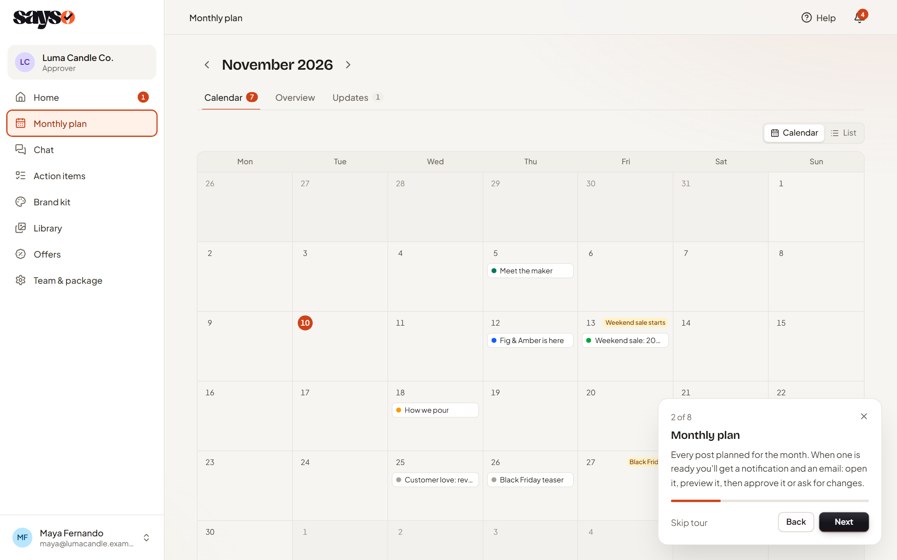
</p>

### See who's active

The Team page lists agency staff and clients, with when each person last used the portal.

<p align="center">
  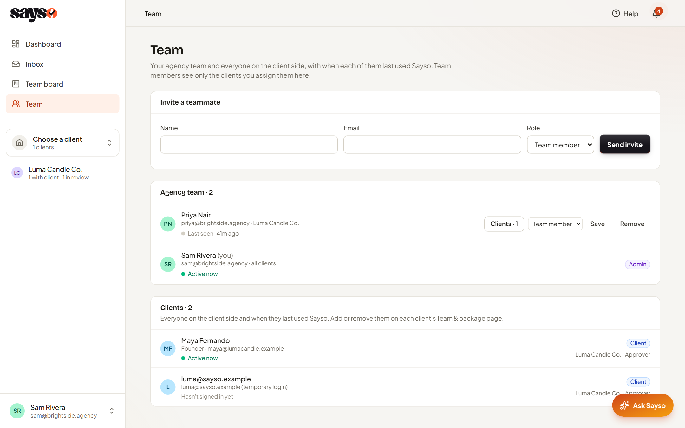
</p>

## What's inside

| | |
|---|---|
| **Approval workflow** | Planned → Draft → Internal review → Client approval → Approved → Scheduled → Published. Every upload is kept as a version, and each approval records which version it was for. |
| **Roles** | Agency admins, team members, client approvers and client viewers. Team members send their work to an admin for review. Once the admin marks it done, the person who made it sends it to the client, and the admin can see whether it has gone. Only an admin publishes. |
| **Publishing** | One click posts an approved post to Instagram and Facebook, and its results (reach, likes, comments) come back into the portal. |
| **Chat** | Real-time chat between each client and the agency team, plus a Direct chat between the client and the agency admins: @mentions, replies (including replying privately), emoji reactions, editing your own messages, photo previews with download, and "Seen by" for the agency. |
| **Library** | Product photos, videos and files in one place. Clients can add files too, which land in their own folder. Download one, a few, or everything as a ZIP. |
| **Offers** | Clients tell the agency about a sale or launch in their own words, so posts can be planned around it. |
| **Tasks** | To-dos for the team and for the client, with a submit-and-review step for team work. Team members can also send work for review that was never on the board. |
| **Notifications** | In the portal and by email, and each person chooses which ones are emailed. |
| **Two time zones** | Every time is shown twice, in the audience's time zone and the agency's, for example "19:30 PT · 09:00 LK". |
| **Arranging posts** | Reorder a post's photos by dragging, and write the caption right under the preview. |
| **3D touches** | A wax seal is pressed onto each post the client approves. On the Brand kit page, the client's logo sits on a 3D tile that turns toward the mouse. Carousels wait behind each other like a stack of prints, cards lean toward the mouse, and empty screens get small 3D pictures. Each one has a still version for people who turn off motion. |
| **Assistant** | A built-in assistant for agency staff that answers questions like "what needs my attention today?" |
| **Privacy** | Each client sees only their own workspace. Clients never see internal notes, drafts or other clients. This is enforced in the database, not just hidden in the interface. |

## Built with

- **[Next.js 16](https://nextjs.org)** (App Router) and **React 19**
- **[Supabase](https://supabase.com)** for the database (Postgres with row-level security), sign-in and real-time updates
- **[Cloudflare R2](https://developers.cloudflare.com/r2/)** for files
- **[Tailwind CSS 4](https://tailwindcss.com)**, [Radix UI](https://www.radix-ui.com) and [Motion](https://motion.dev) for the interface
- **[three.js](https://threejs.org)** for the 3D logo and the rendered 3D pictures
- **[Resend](https://resend.com)** for email
- **[Make](https://www.make.com)** for publishing to Instagram and Facebook
- **[Claude](https://www.anthropic.com/claude)** for the assistant

## Run it yourself

You need Node 20 or newer and Docker Desktop running.

```bash
git clone https://github.com/Mohrimz/sayso.git
cd sayso
cp .env.example .env.local   # then fill in the Supabase keys that `db:start` prints
npm install
npm run db:start             # starts a local Supabase
npm run db:reset             # creates the tables and two local logins
npm run dev                  # http://localhost:3000
```

Sign in with `admin@sayso.test` (agency admin) or `team@sayso.test` (team member). The password for both is `password123`, and they exist only on your machine. Add a client from the Dashboard to start exploring.

Email, file storage, publishing and the assistant are all optional. Without them, emails are printed to the terminal and files are kept in Supabase.

The **[handbook](docs/HANDBOOK.md)** covers how each feature works, the permissions table, and how to deploy.

## About

Built by [Mohomed Rimzan](https://github.com/Mohrimz) for a working social media agency and its clients.
